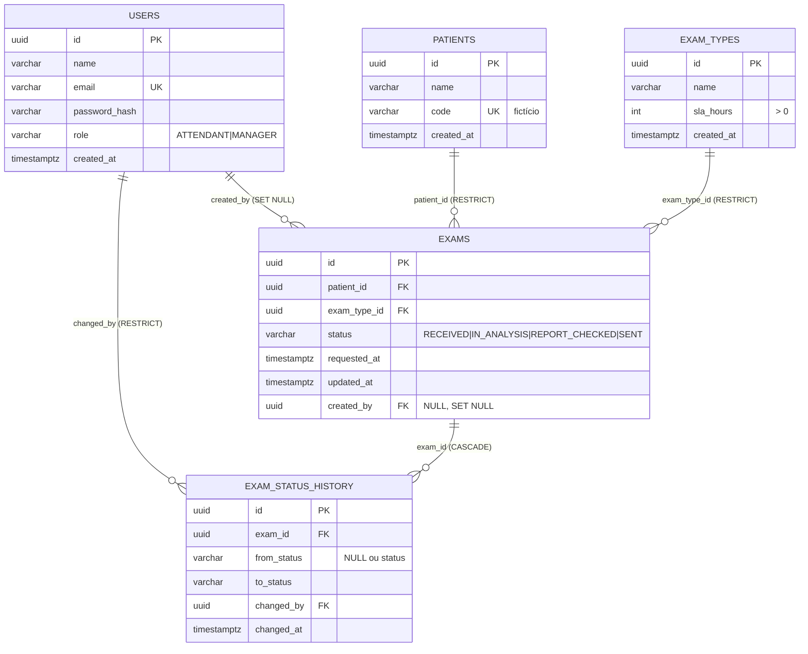

# Validação do Schema do Banco de Dados - PR #3

Este documento resume as decisões de modelagem validadas com domain-modeling para as 4 migrações do PR #3.

---

## Migração 001: `users`

| Coluna          | Tipo         | Constraints                                 | Decisão |
| --------------- | ------------ | ------------------------------------------- | ------- |
| `id`            | UUID         | PK, `gen_random_uuid()`                     | ✅      |
| `name`          | VARCHAR(255) | NOT NULL                                    | ✅      |
| `email`         | VARCHAR(255) | NOT NULL, UNIQUE                            | ✅      |
| `password_hash` | VARCHAR(255) | NOT NULL                                    | ✅      |
| `role`          | VARCHAR(20)  | NOT NULL, CHECK IN ('ATTENDANT', 'MANAGER') | ✅      |
| `created_at`    | TIMESTAMPTZ  | NOT NULL, DEFAULT now()                     | ✅      |

**Validação**: Alinhado com PR. Role como CHECK constraint (não enum type) para simplicidade e portabilidade.

---

## Migração 002: `patients` e `exam_types`

### `patients`

| Coluna       | Tipo         | Constraints             | Decisão                            |
| ------------ | ------------ | ----------------------- | ---------------------------------- |
| `id`         | UUID         | PK, `gen_random_uuid()` | ✅                                 |
| `name`       | VARCHAR(255) | NOT NULL                | ✅                                 |
| `code`       | VARCHAR(50)  | NOT NULL, UNIQUE        | ✅ (código fictício por segurança) |
| `created_at` | TIMESTAMPTZ  | NOT NULL, DEFAULT now() | ✅                                 |

### `exam_types`

| Coluna       | Tipo         | Constraints             | Decisão |
| ------------ | ------------ | ----------------------- | ------- |
| `id`         | UUID         | PK, `gen_random_uuid()` | ✅      |
| `name`       | VARCHAR(255) | NOT NULL                | ✅      |
| `sla_hours`  | INTEGER      | NOT NULL, CHECK > 0     | ✅      |
| `created_at` | TIMESTAMPTZ  | NOT NULL, DEFAULT now() | ✅      |

**Validação**: Alinhado com PR. `sla_hours` INTEGER com CHECK > 0 garante SLA positivo.

---

## Migração 003: `exams`

| Coluna         | Tipo        | Constraints                                                                               | Decisão                          |
| -------------- | ----------- | ----------------------------------------------------------------------------------------- | -------------------------------- |
| `id`           | UUID        | PK, `gen_random_uuid()`                                                                   | ✅                               |
| `patient_id`   | UUID        | NOT NULL, FK → patients(id) ON DELETE RESTRICT                                            | ✅                               |
| `exam_type_id` | UUID        | NOT NULL, FK → exam_types(id) ON DELETE RESTRICT                                          | ✅                               |
| `status`       | VARCHAR(20) | NOT NULL, DEFAULT 'RECEIVED', CHECK IN ('RECEIVED','IN_ANALYSIS','REPORT_CHECKED','SENT') | ✅                               |
| `requested_at` | TIMESTAMPTZ | NOT NULL, DEFAULT now()                                                                   | ✅                               |
| `updated_at`   | TIMESTAMPTZ | NOT NULL, DEFAULT now()                                                                   | ✅                               |
| `created_by`   | UUID        | **NULL**, FK → users(id) **ON DELETE SET NULL**                                           | ⚠️ Alterado: nullable + SET NULL |

**Índices**:

- `idx_exams_status` ON `exams(status)` ✅
- `idx_exams_requested_at` ON `exams(requested_at)` ✅

**Decisões validadas**:

1. `created_by` **NULL + SET NULL**: se atendente for removido, exame permanece (auditoria), mas ligação se perde
2. Status como VARCHAR + CHECK: simplicidade, sem tipo enum customizado
3. Fluxo linear (RECEIVED → IN_ANALYSIS → REPORT_CHECKED → SENT) **apenas na camada de aplicação** (service valida em transação única com histórico)

---

## Migração 004: `exam_status_history`

| Coluna        | Tipo        | Constraints                                 | Decisão                                      |
| ------------- | ----------- | ------------------------------------------- | -------------------------------------------- |
| `id`          | UUID        | PK, `gen_random_uuid()`                     | ✅                                           |
| `exam_id`     | UUID        | NOT NULL, FK → exams(id) ON DELETE CASCADE  | ✅                                           |
| `from_status` | VARCHAR(20) | **NULL**, CHECK IN (...)                    | ⚠️ Alterado: **nullable** para linha inicial |
| `to_status`   | VARCHAR(20) | NOT NULL, CHECK IN (...)                    | ✅                                           |
| `changed_by`  | UUID        | NOT NULL, FK → users(id) ON DELETE RESTRICT | ✅                                           |
| `changed_at`  | TIMESTAMPTZ | NOT NULL, DEFAULT now()                     | ✅                                           |

**Constraints adicionais**:

- CHECK: `from_status IS NULL OR from_status != to_status` ✅

**Índice**:

- `idx_exam_status_history_exam_id` ON `exam_status_history(exam_id)` ✅

**Decisões validadas**:

1. `from_status` **NULLABLE**: primeira linha (criação) tem `from_status=NULL, to_status='RECEIVED'`
2. CASCADE no `exam_id`: histórico sem exame não faz sentido
3. RESTRICT no `changed_by`: não pode deletar usuário que fez mudança de status

---

## Seed Script - Dados Fictícios (Regra Crítica: 100% fictícios)

| Entidade   | Quantidade | Detalhes                                                                                                                                         |
| ---------- | ---------- | ------------------------------------------------------------------------------------------------------------------------------------------------ |
| Users      | 2          | 1 ATTENDANT, 1 MANAGER                                                                                                                           |
| Patients   | 20         | Nomes e códigos fictícios (ex: `PAC-0001`, `PAC-0002`...)                                                                                        |
| Exam Types | 5          | Nomes genéricos + sla_hours variados (ex: 4h, 8h, 24h, 48h, 72h)                                                                                 |
| Exams      | 200        | Distribuídos entre pacientes/tipos, `requested_at` variados (últimos 30 dias), ~20% atrasados (status ≠ SENT e requested_at + sla_hours < now()) |

---

## Diagrama ER (para anexar no PR)

---

## Checklist de Conformidade com PR #3

- [x] Migração 001 `users`: id, name, email (único), password_hash, role (ATTENDANT/MANAGER), created_at
- [x] Migração 002 `patients`: id, name, code (fictício único), created_at + `exam_types`: id, name, sla_hours
- [x] Migração 003 `exams`: id, patient_id, exam_type_id, status (4 valores), requested_at, updated_at, created_by, FKs + índices em status e requested_at
- [x] Migração 004 `exam_status_history`: id, exam_id, from_status, to_status, changed_by, changed_at
- [x] Seed: 2 usuários, 20 pacientes, 5 tipos, 200 exames com datas variadas, alguns atrasados
- [x] Decisões documentadas em ADR 0001
- [x] Glossário atualizado com termos do domínio
