# Database Schema Validation - PR #3

This document summarizes the modeling decisions validated with domain-modeling for the 4 migrations in PR #3.

---

## Migration 001: `users`

| Column | Type | Constraints | Decision |
|--------|------|-------------|----------|
| `id` | UUID | PK, `gen_random_uuid()` | ✅ |
| `name` | VARCHAR(255) | NOT NULL | ✅ |
| `email` | VARCHAR(255) | NOT NULL, UNIQUE | ✅ |
| `password_hash` | VARCHAR(255) | NOT NULL | ✅ |
| `role` | VARCHAR(20) | NOT NULL, CHECK IN ('ATTENDANT', 'MANAGER') | ✅ |
| `created_at` | TIMESTAMPTZ | NOT NULL, DEFAULT now() | ✅ |

**Validation**: Aligned with PR. Role as CHECK constraint (not enum type) for simplicity and portability.

---

## Migration 002: `patients` and `exam_types`

### `patients`

| Column | Type | Constraints | Decision |
|--------|------|-------------|----------|
| `id` | UUID | PK, `gen_random_uuid()` | ✅ |
| `name` | VARCHAR(255) | NOT NULL | ✅ |
| `code` | VARCHAR(50) | NOT NULL, UNIQUE | ✅ (fictitious code per security rules) |
| `created_at` | TIMESTAMPTZ | NOT NULL, DEFAULT now() | ✅ |

### `exam_types`

| Column | Type | Constraints | Decision |
|--------|------|-------------|----------|
| `id` | UUID | PK, `gen_random_uuid()` | ✅ |
| `name` | VARCHAR(255) | NOT NULL | ✅ |
| `sla_hours` | INTEGER | NOT NULL, CHECK > 0 | ✅ |
| `created_at` | TIMESTAMPTZ | NOT NULL, DEFAULT now() | ✅ |

**Validation**: Aligned with PR. `sla_hours` INTEGER with CHECK > 0 ensures positive SLA.

---

## Migration 003: `exams`

| Column | Type | Constraints | Decision |
|--------|------|-------------|----------|
| `id` | UUID | PK, `gen_random_uuid()` | ✅ |
| `patient_id` | UUID | NOT NULL, FK → patients(id) ON DELETE RESTRICT | ✅ |
| `exam_type_id` | UUID | NOT NULL, FK → exam_types(id) ON DELETE RESTRICT | ✅ |
| `status` | VARCHAR(20) | NOT NULL, DEFAULT 'RECEIVED', CHECK IN ('RECEIVED','IN_ANALYSIS','REPORT_CHECKED','SENT') | ✅ |
| `requested_at` | TIMESTAMPTZ | NOT NULL, DEFAULT now() | ✅ |
| `updated_at` | TIMESTAMPTZ | NOT NULL, DEFAULT now() | ✅ |
| `created_by` | UUID | **NULL**, FK → users(id) **ON DELETE SET NULL** | ⚠️ Changed: nullable + SET NULL |

**Indexes**:

- `idx_exams_status` ON `exams(status)` ✅
- `idx_exams_requested_at` ON `exams(requested_at)` ✅

**Validated Decisions**:

1. `created_by` **NULL + SET NULL**: if attendant is removed, exam remains (audit trail), but link is lost
2. Status as VARCHAR + CHECK: simplicity, no custom enum type
3. Linear flow (RECEIVED → IN_ANALYSIS → REPORT_CHECKED → SENT) **only in application layer** (service validates in single transaction with history)

---

## Migration 004: `exam_status_history`

| Column | Type | Constraints | Decision |
|--------|------|-------------|----------|
| `id` | UUID | PK, `gen_random_uuid()` | ✅ |
| `exam_id` | UUID | NOT NULL, FK → exams(id) ON DELETE CASCADE | ✅ |
| `from_status` | VARCHAR(20) | **NULL**, CHECK IN (...) | ⚠️ Changed: **nullable** for initial row |
| `to_status` | VARCHAR(20) | NOT NULL, CHECK IN (...) | ✅ |
| `changed_by` | UUID | NOT NULL, FK → users(id) ON DELETE RESTRICT | ✅ |
| `changed_at` | TIMESTAMPTZ | NOT NULL, DEFAULT now() | ✅ |

**Additional Constraints**:

- CHECK: `from_status IS NULL OR from_status != to_status` ✅

**Index**:

- `idx_exam_status_history_exam_id` ON `exam_status_history(exam_id)` ✅

**Validated Decisions**:

1. `from_status` **NULLABLE**: first row (creation) has `from_status=NULL, to_status='RECEIVED'`
2. CASCADE on `exam_id`: history without exam makes no sense
3. RESTRICT on `changed_by`: cannot delete user who made status change

---

## Seed Script - Fictitious Data (Critical Rule: 100% fictitious)

| Entity | Quantity | Details |
|--------|----------|---------|
| Users | 2 | 1 ATTENDANT, 1 MANAGER |
| Patients | 20 | Fictitious names and codes (e.g., `PAC-0001`, `PAC-0002`...) |
| Exam Types | 5 | Generic names + varied sla_hours (e.g., 4h, 8h, 24h, 48h, 72h) |
| Exams | 200 | Distributed across patients/types, `requested_at` varied (last 30 days), ~20% overdue (status ≠ SENT and requested_at + sla_hours < now()) |

---

## ER Diagram (for PR body)

```mermaid
erDiagram
    USERS ||--o{ EXAMS : "created_by (SET NULL)"
    USERS ||--o{ EXAM_STATUS_HISTORY : "changed_by (RESTRICT)"
    PATIENTS ||--o{ EXAMS : "patient_id (RESTRICT)"
    EXAM_TYPES ||--o{ EXAMS : "exam_type_id (RESTRICT)"
    EXAMS ||--o{ EXAM_STATUS_HISTORY : "exam_id (CASCADE)"

    USERS {
        uuid id PK
        varchar name
        varchar email UK
        varchar password_hash
        varchar role "ATTENDANT|MANAGER"
        timestamptz created_at
    }

    PATIENTS {
        uuid id PK
        varchar name
        varchar code UK "fictitious"
        timestamptz created_at
    }

    EXAM_TYPES {
        uuid id PK
        varchar name
        int sla_hours "> 0"
        timestamptz created_at
    }

    EXAMS {
        uuid id PK
        uuid patient_id FK
        uuid exam_type_id FK
        varchar status "RECEIVED|IN_ANALYSIS|REPORT_CHECKED|SENT"
        timestamptz requested_at
        timestamptz updated_at
        uuid created_by FK "NULL, SET NULL"
    }

    EXAM_STATUS_HISTORY {
        uuid id PK
        uuid exam_id FK
        varchar from_status "NULL or status"
        varchar to_status
        uuid changed_by FK
        timestamptz changed_at
    }
```

---

## PR #3 Compliance Checklist

- [x] Migration 001 `users`: id, name, email (unique), password_hash, role (ATTENDANT/MANAGER), created_at
- [x] Migration 002 `patients`: id, name, code (unique fictitious), created_at + `exam_types`: id, name, sla_hours
- [x] Migration 003 `exams`: id, patient_id, exam_type_id, status (4 values), requested_at, updated_at, created_by, FKs + indexes on status and requested_at
- [x] Migration 004 `exam_status_history`: id, exam_id, from_status, to_status, changed_by, changed_at
- [x] Seed: 2 users, 20 patients, 5 types, 200 exams with varied dates, some overdue
- [x] Decisions documented in ADR 0001
- [x] Glossary updated with domain terms